<div align="center">

# Doppel: Render the Robot, Generate the World

### One Video World Model Across Embodiments

<p>
<a href="https://doppelwm.github.io/"></a>
<a href="https://huggingface.co/sourlreapwr/doppel-emb8"></a>
<a href="https://huggingface.co/datasets/sourlreapwr/doppel-camera-extrinsics"></a>
<a href="LICENSE"></a>
</p>

[Yash Jangir](https://offjangir.github.io/)<sup>1</sup>, Karan Mirakhor<sup>2</sup>, Renos Zabounidis<sup>2</sup>, [Muhammad Zubair Irshad](https://zubairirshad.com/)<sup>3</sup>, [Sergey Zakharov](https://zakharos.github.io/)<sup>3</sup>, [Yonatan Bisk](https://yonatanbisk.com/)<sup>2</sup>, [Homanga Bharadhwaj](https://homangab.github.io/)<sup>1</sup>

<sup>1</sup>Johns Hopkins University &nbsp;&nbsp; <sup>2</sup>Carnegie Mellon University &nbsp;&nbsp; <sup>3</sup>Toyota Research Institute

&nbsp;&nbsp;&nbsp;&nbsp;&nbsp;&nbsp;&nbsp;&nbsp;

</div>

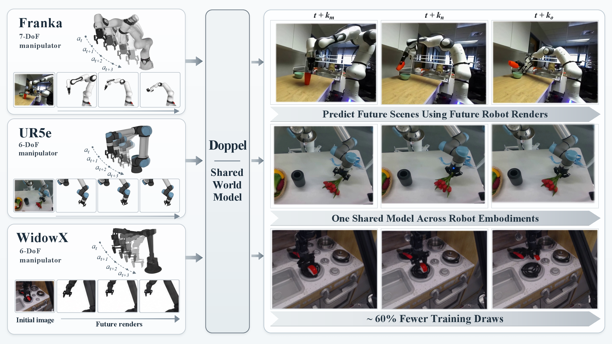

**Doppel** is an action-conditioned video world model that predicts how an embodiment and its surroundings evolve. Instead of learning from numerical actions alone, Doppel renders the embodiment along the commanded trajectory from the camera's viewpoint and conditions a video model on both the rendering and the action vector. The rendering shows where the body will move in the image, so the model can focus on how the scene responds.

One set of weights covers eight datasets: robot arms (Franka, UR5e, WidowX), a bimanual YAM robot, a humanoid with dexterous hands, human hands and human bodies, with a shared action encoder and no embodiment label. Doppel builds on Wan 2.1 image-to-video (14B) with a render-action adapter that gives every video token its own timestep modulation.

## Latest updates

**11/06/2026**: Code, Doppel-8 weights, camera extrinsics for 45k robot demonstrations and the calibration code released.

## Results

### Held-out scenes on robot arms

<table>
<thead>
<tr>
<th align="center"></th>
<th align="center">Ground truth</th>
<th align="center">Action-only</th>
<th align="center"><b>Doppel</b></th>
</tr>
</thead>
<tbody>
<tr>
<td align="center"><b>DROID (Franka)</b></td>
<td align="center">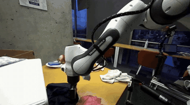</td>
<td align="center">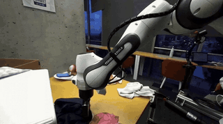</td>
<td align="center">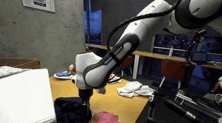</td>
</tr>
<tr>
<td align="center"><b>Bridge (WidowX)</b></td>
<td align="center">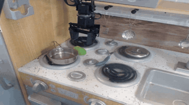</td>
<td align="center">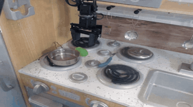</td>
<td align="center">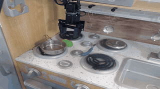</td>
</tr>
<tr>
<td align="center"><b>RoboMIND (UR5e)</b></td>
<td align="center">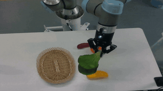</td>
<td align="center">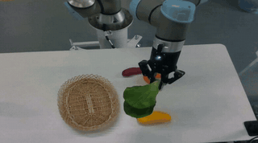</td>
<td align="center">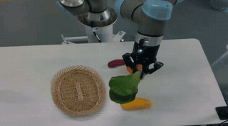</td>
</tr>
</tbody>
</table>

### Eight embodiments, one model

<table>
<thead>
<tr>
<th align="center"></th>
<th align="center">Rendering (input)</th>
<th align="center">Ground truth</th>
<th align="center"><b>Doppel</b></th>
</tr>
</thead>
<tbody>
<tr>
<td align="center"><b>ABC (bimanual YAM)</b></td>
<td align="center">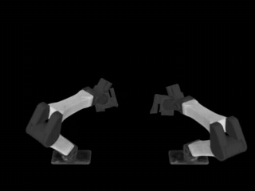</td>
<td align="center">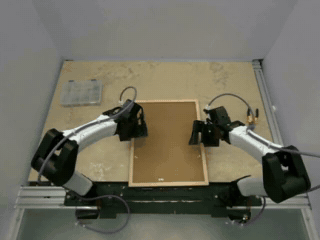</td>
<td align="center">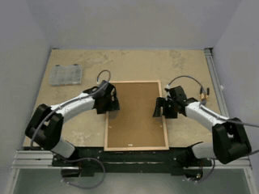</td>
</tr>
<tr>
<td align="center"><b>T-Rex (humanoid + dexterous hands)</b></td>
<td align="center">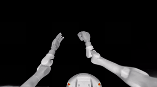</td>
<td align="center">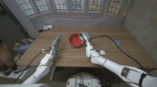</td>
<td align="center">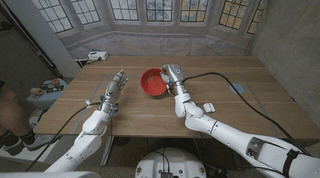</td>
</tr>
<tr>
<td align="center"><b>Ego-Exo4D (human body)</b></td>
<td align="center">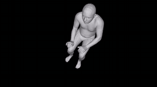</td>
<td align="center">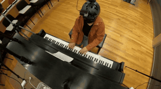</td>
<td align="center">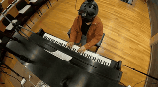</td>
</tr>
<tr>
<td align="center"><b>GigaHands (human hands)</b></td>
<td align="center">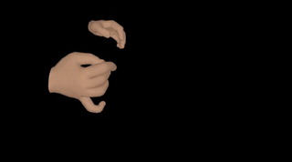</td>
<td align="center">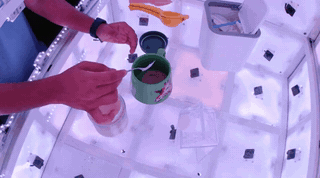</td>
<td align="center">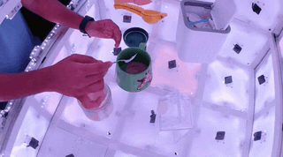</td>
</tr>
<tr>
<td align="center"><b>OakInk2 (human upper body)</b></td>
<td align="center">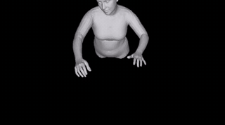</td>
<td align="center"></td>
<td align="center">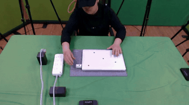</td>
</tr>
</tbody>
</table>

All clips are held-out test episodes; the model sees only the first frame, the rendering and the actions.

### Long horizon

25.6 s of an OakInk2 test episode predicted from its first frame alone, by chaining 3.2 s windows on the model's own predictions.

<table>
<thead><tr><th align="center">Rendering (input)</th><th align="center">Ground truth</th><th align="center"><b>Doppel</b></th></tr></thead>
<tbody><tr>
<td align="center">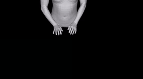</td>
<td align="center">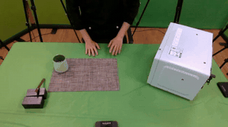</td>
<td align="center">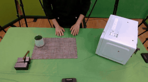</td>
</tr></tbody>
</table>

## Architecture

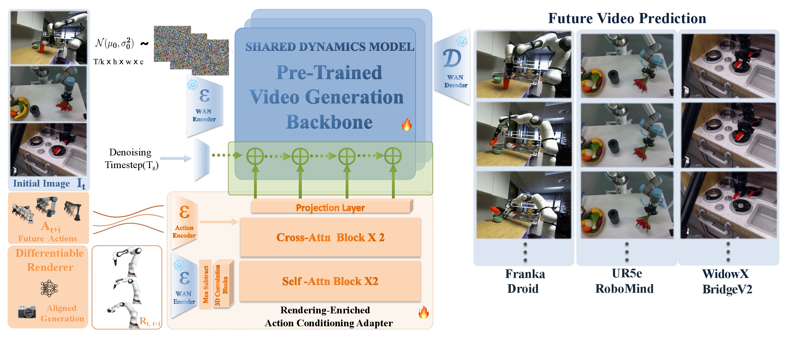

The rendering is encoded with the frozen Wan VAE, mean-centered and turned into tokens on the backbone's grid; the action trajectory is encoded per frame and fused into the render tokens by cross-attention. The fused token is added to the flow-matching timestep embedding, so every block (and the output norm) receives a per-token shift, scale and gate.

## Model checkpoints

| Model | Training data | Weights |
| :-- | :-- | :-- |
| Doppel-8 | 8 datasets, 803,602 clips (about 600 h) | [doppel-emb8](https://huggingface.co/sourlreapwr/doppel-emb8) |
| Dr.Robot robot models | Franka FR3, UR5e, WidowX, YAM (renderings and calibration) | [doppel-drrobot](https://huggingface.co/sourlreapwr/doppel-drrobot) |

PSNR on 200 held-out clips per split (validation: unseen trajectories / test: unseen scenes or objects), predicted frames 1 to 16:

| Method | DROID val | DROID test | Bridge val | Bridge test | RoboMIND val | RoboMIND test |
| :-- | :-: | :-: | :-: | :-: | :-: | :-: |
| Action-only (per dataset) | 22.89 | 20.07 | 26.29 | 20.58 | 30.47 | 30.10 |
| OSCAR (fine-tuned) | 20.43 | 18.62 | 22.56 | 19.49 | 27.46 | 27.66 |
| Doppel (per dataset) | 24.36 | 21.28 | **26.62** | 21.72 | 31.10 | 30.29 |
| Doppel (3 robots) | 24.30 | 21.25 | 26.55 | **22.47** | 31.07 | 30.44 |
| **Doppel-8** | **24.82** | **21.46** | 26.54 | 22.24 | **31.30** | **30.66** |

Doppel-8 on the five other datasets:

| | ABC | T-Rex | Ego-Exo4D | GigaHands | OakInk2 |
| :-- | :-: | :-: | :-: | :-: | :-: |
| PSNR val / test | 24.65 / 25.22 | 28.33 / 28.35 | 27.94 / 27.61 | 25.62 / 25.78 | 29.01 / 29.09 |
| LPIPS val / test | 0.096 / 0.089 | 0.050 / 0.051 | 0.045 / 0.044 | 0.053 / 0.049 | 0.036 / 0.033 |

## Camera extrinsics

Rendering needs the camera pose relative to the robot. We release the extrinsics and intrinsics we recovered for 45,345 demonstrations (Bridge, RoboMIND and ABC) on [Hugging Face](https://huggingface.co/datasets/sourlreapwr/doppel-camera-extrinsics).

## Camera calibration

`calibration/` contains the code that recovered these extrinsics: a per-session fit for Bridge and RoboMIND
(Dr.Robot renderer with RAFT flow, RGB and DINOv2 features, following RobotArena∞) and a per-video fit for ABC
(SAM 2 arm masks and photometric refinement). See [`calibration/README.md`](calibration/README.md) for setup,
commands and output conventions.

## Installation

Python >= 3.10. Install PyTorch (>= 2.5) and a matching torchvision first, then:

```bash
pip install -e .              # model, training, inference
pip install -e ".[eval]"      # + metrics (scikit-image, torchmetrics, SAM 2)
pip install -e ".[data]"      # + data preparation scripts
```

`requirements.txt` pins the versions we evaluated with.

## Weights

Backbone (all models were trained from this revision):

```bash
huggingface-cli download Wan-AI/Wan2.1-I2V-14B-480P-Diffusers \
    --revision b184e23a8a16b20f108f727c902e769e873ffc73 --local-dir checkpoints/wan2.1-i2v-14b-480p
```

Doppel weights (8-embodiment model):

```bash
hf download sourlreapwr/doppel-emb8 --local-dir checkpoints/doppel-emb8
```

The repository It contains
`config.json`, the action statistics and `transformer_overlay/`, the fine-tuned transformer tensors (EMA weights)
in safetensors format. All other weights come from the Wan checkpoint. Training runs save `conditioner.pt` +
`meta.json` instead; both formats load the same way.

## Inference

One 80 GB GPU, bf16.

```python
import numpy as np
from doppel.inference import DoppelWorldModel

wm = DoppelWorldModel.from_pretrained(
    checkpoint="checkpoints/doppel-emb8",
    config="checkpoints/doppel-emb8/config.json",
    model_path="checkpoints/wan2.1-i2v-14b-480p")

actions = np.load("example/actions.npz")["state"]   # (17, D) raw states
video = wm.predict(image="example/frame0.png", render="example/render.mp4",
                   actions=actions, robot_type="panda", seed=0)
# uint8 (17, 240, 432, 3); frame 0 is the input frame
```

Command line:

```bash
python -m doppel.inference --config checkpoints/doppel-emb8/config.json \
    --checkpoint checkpoints/doppel-emb8 --model_path checkpoints/wan2.1-i2v-14b-480p \
    --video clip.mp4 --render render.mp4 --actions actions.npz --robot_type panda --out out/pred.mp4
```

Settings used in the paper: 50 Euler steps, guidance scale 1.0, empty prompt, 17 frames at 240x432 (Lanczos
resize, no crop).

Chained rollout over consecutive 17-frame windows (each window starts from the previous predicted last frame;
episode format in `doppel/rollout.py`):

```bash
python -m doppel.rollout --config checkpoints/doppel-emb8/config.json \
    --checkpoint checkpoints/doppel-emb8 --model_path checkpoints/wan2.1-i2v-14b-480p \
    --episode episode.json --out out/rollout.mp4
```

## Data format

A clip is 17 frames: the camera video (mp4), the rendering of the embodiment from the same camera (mp4, black
background) and the actions (npz, `state` of shape (17, D)). Actions are per-frame states, not deltas:

| robot_type | dataset | D | layout |
|---|---|---|---|
| `panda` | DROID | 8 | 7 joints, gripper |
| `ur5e_2f85` | RoboMIND | 8 | 6 joints, 0, gripper |
| `widowx` | Bridge | 8 | 6 joints, 0, gripper |
| `yam_bimanual` | ABC | 14 | 2 x (6 joints, gripper) |
| `vega1_sharpa` | T-Rex | 58 | 2 x (7 arm joints, 22 hand joints) |
| `mano_hands` | GigaHands | 108 | 2 x (wrist 6-D rotation, wrist xyz, 15 x 3 finger joints) |
| `smplx_human` | OakInk2 | 159 | root rotation, pelvis xyz, 21 x 3 body, 2 x 15 x 3 hands |
| `smplh_human` | Ego-Exo4D | 159 | same as `smplx_human` |

Grippers are closures in [0, 1]. Slot definitions are in `doppel/assets/embodiments.json`; slots marked unused
(dof_mask 0) must be 0. Pass raw states: the loader unwraps the SMPL root rotation, z-scores with
`doppel/assets/action_stats/<robot_type>.json` and zero-pads to 159 for the 8-embodiment model.

## Training

Training reads precomputed VAE / CLIP / text-encoder outputs from a latent store
(`scripts/data/build_latent_store.py`) and an index built by `scripts/data/build_index.py`. Paths in
`configs/` are placeholders.

```bash
# single dataset, 8 GPUs
accelerate launch --num_processes 8 --config_file configs/accelerate_fsdp.yaml \
    -m doppel.train --config configs/droid_render_action.json

# 3-robot and 8-embodiment models, 4 nodes x 8 GPUs (run on every node)
accelerate launch --config_file configs/accelerate_fsdp.yaml --num_machines 4 --num_processes 32 \
    --machine_rank <0-3> --main_process_ip <node 0> --main_process_port <port> \
    -m doppel.train --config configs/emb8_render_action_4node.json
```

| Config | GPUs | Global batch | LR (adapter x4) | Warmup | EMA | Epochs x clips |
|---|---|---|---|---|---|---|
| `{droid,bridge,robomind}_*.json`, `multi_*.json` | 8 | 64 | 5e-6 | 500 | 0.9975 | 990 x 4,864 |
| `multi_render_action_4node.json` | 32 | 256 | 1e-5 | 250 | 0.995 | 651 x 19,456 |
| `emb8_render_action_4node.json` | 32 | 256 | 1e-5 | 250 | 0.995 | 2,490 x 19,456 |

All models fine-tune the 40 Wan blocks and the adapter with AdamW (weight decay 1e-3, clipping 1.0), cosine
decay to 5%, conditioning dropout 0.1 and EMA updates every 10 steps. `*_action_only.json` are the action-only
baselines. See `python -m doppel.train --help` for all options and `doppel/train.py` for resuming.

## Evaluation

```bash
python scripts/eval/evaluate.py --config checkpoints/doppel-emb8/config.json \
    --checkpoint checkpoints/doppel-emb8 --model_path checkpoints/wan2.1-i2v-14b-480p \
    --evalset evalsets/test_droid.csv --data_root data --out results/emb8.jsonl
python scripts/eval/summarize.py results/emb8.jsonl --by evalset
```

The eval set is a CSV with columns `video`, `render`, `actions`, `robot_type`, `dataset` and optionally
`row_key` and `evalset`. PSNR, SSIM and LPIPS (AlexNet) are averaged over frames 1-16. SCS uses SAM 2
(`facebook/sam2.1-hiera-small`); the paper's SCS is `scs_objects` (objects other than the embodiment).
Each clip's seed is derived from its `row_key`.

## Tests

```bash
pytest tests        # CPU only
```

## License

Code: MIT (see `LICENSE`). Model weights: CC BY-NC 4.0. Wan 2.1 is licensed separately by its authors
(Apache-2.0).

## Citation

```bibtex
@article{jangir2026doppel,
  title   = {Render the Robot, Generate the World: One Video World Model Across Embodiments},
  author  = {Jangir, Yash and Mirakhor, Karan and Zabounidis, Renos and Irshad, Muhammad Zubair and
             Zakharov, Sergey and Bisk, Yonatan and Bharadhwaj, Homanga},
  journal = {arXiv preprint},
  year    = {2026}
}
```
